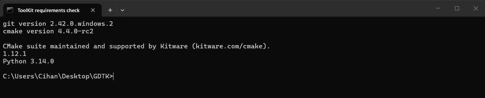
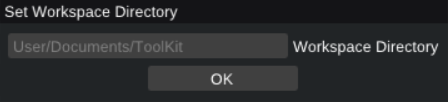
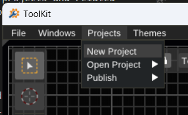
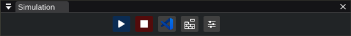

# ToolKit

ToolKit is a 3D editor and interactive application development platform. It lets you build 3D scenes and bring in the interactivity through C++ plug-ins. The editor, the launcher, the import and pack tools, and the engine library are all part of this repository and all build from one CMake tree.

Current version: **v0.5.0** (`TKVersionStr` in `ToolKit/Source/Types.h`).

## Motivation

### Simplicity

Many games and interactive projects don't require the vast toolsets offered by engines like Unity, Unreal, or even Godot. For developers seeking a clearer understanding and greater control over their work, a simpler engine often leads to better results. ToolKit embraces this philosophy by offering a minimal yet powerful alternative that emphasizes clarity, performance, and modern architecture.

ToolKit is not designed to compete with enterprise-level engines. Instead, it is tailored for indie developers, researchers, and creative technologists who value understanding the entire stack and want to build things their way.

ToolKit is built with a strong emphasis on modularity. Instead of bundling everything into the core, we develop all non-essential features such as editors, scripting, physics, and more as separate modules. This approach keeps the engine lightweight, bloat-free, and highly customizable, empowering developers to use only what they need while keeping full control over their stack. Our goal is to maintain a modern, minimal core that can be extended cleanly through well-defined modules.

### Community

We believe that great tools are shaped by communities with shared values. Like Blender and Godot, ToolKit aims to foster a culture of openness, simplicity, and collaborative innovation. Whether you're here to learn, contribute, or build something entirely new, ToolKit is a platform for developers who seek to create unique and modern experiences without the bloat.

If you value simplicity over complexity, learning over abstraction, and collaboration over competition, we invite you to join us.

## Platforms

ToolKit builds and runs on **Windows** and **Linux**. Windows is the primary development OS for the Editor; Linux is built with GCC or Clang from the same CMake tree.

A project can be published for:

- Windows (exe)
- Linux
- Web (html + .wasm / .js)
- Android (apk)

Publishing runs from the editor with a button, but each target has its own prerequisites such as Emscripten or the Android SDK. See `Editor/Source/PublishManager.cpp` for what each target invokes.


## Projects Using ToolKit


[**Multiverse Go**](https://store.steampowered.com/app/2346880/Multiverse_GO/)

Multiverse GO is a turn-based puzzle adventure set in a group of multiple universes. You can explore the multiverse and face challenges. The game focuses on forward thinking to progress through levels. Check out the link for more visuals from the project.

**Don't Forget to Wishlist the Game in Steam !**

## Repository Layout

| Path | What lives there |
|------|------------------|
| `ToolKit/` | The engine library: rendering, resources, ECS, UI, platform helpers. |
| `Editor/` | The editor application, including the scene viewport, windows and publish flow. |
| `Utils/Launcher` | Project browser: picks the workspace, creates and opens projects. |
| `Utils/Import` | Headless asset import tool. |
| `Utils/Packer` | Packs project content into the `.pak` archives the runtime reads. |
| `Modules/Workspace` | Workspace / project bookkeeping shared by the hosts above. |
| `Dependency/` | Vendored third party libraries, built by their own CMake project. |
| `BuildScripts/` | Python drivers for both CMake builds, plus an optional Tkinter GUI. |
| `Resources/Engine/` | Engine shaders, icons, fonts and default materials. |
| `Templates/` | `Game` and `Plugin` project templates the editor instantiates. |
| `Config/` | Default editor / engine settings files. |
| `Images/` | Screenshots used by this README. |
| `gdtk-overview.md` | Architecture notes: the first thing to read before changing engine code. |
| `AGENTS.md` | Coding standards for the repository. |

## Building

ToolKit uses CMake for everything. There are two separate CMake builds: the vendored dependencies under `Dependency/` and the engine plus its hosts (Editor, Launcher, Import, Packer) at the repository root. The Python scripts under `BuildScripts/` drive both, and behave the same on Windows and Linux. Raw CMake commands are given further down for advanced usage.

### Requirements

| Tool | Notes |
|------|-------|
| Git | To clone the repo and pull the dependency submodules. |
| CMake | 3.16 or newer is what the CMake files ask for. Use a recent one: the newest Visual Studio generators (for example `Visual Studio 18 2026`) need a newer CMake than their release year suggests. |
| Python | 3.7 or newer, standard library only. `BuildScripts/` uses `from __future__ import annotations`, which is why 3.6 is not enough. Drives the build scripts and the optional GUI. |
| C/C++ compiler | Windows: MSVC through Visual Studio 2022 or 2026 with the "Desktop development with C++" workload. The build script finds the installation and picks the matching generator itself. Linux: GCC or Clang. |
| Ninja | Optional and faster on Linux. On Windows the script prefers the Visual Studio generator instead, and refuses `--generator ninja` with VS 2026 or newer: the MSVC STL there expects the MSBuild pipeline (Clang front end) and a Ninja build fails with a wall of STL errors. |
| VSCode + C/C++ Extension Pack | Only needed for game / plug-in development, which is the workflow ToolKit generates. |

Make sure `git` and `cmake` (and `ninja` if installed) are recognized from the console, as in the screenshot below.



#### Linux only: X11 development packages

SDL2's Linux video backend is X11, so the matching development headers must be installed **before** the dependency build:

- Fedora / RHEL: `sudo dnf install libX11-devel libXext-devel libXrandr-devel libXcursor-devel libXi-devel libXinerama-devel libxkbcommon-devel`
- Debian / Ubuntu: `sudo apt install libx11-dev libxext-dev libxrandr-dev libxcursor-dev libxi-dev libxinerama-dev libxkbcommon-dev`
- Arch: `sudo pacman -S libx11 libxext libxrandr libxcursor libxi libxinerama libxkbcommon`

The build script probes for these and aborts with the exact install command when something is missing. Pass `--install-deps` to have it install the packages for you.

### Quick start (recommended)

```bash
git clone https://github.com/Oyun-Teknolojileri/GDTK.git
cd GDTK

# One command: pulls submodules, builds the dependencies, builds the
# engine and tools, then installs everything into Bin<Config>/.
# On Windows use "python" instead of "python3".
python3 BuildScripts/build_gdtk.py --configs Debug
```

A cold clone needs only this one command: the script runs the dependency build itself when the dependency tree is missing, and it picks the generator itself - the Visual Studio generator on Windows (Ninja there only when there is no MSVC to use), Ninja on Linux when it is installed. Useful variations:

```bash
python3 BuildScripts/build_gdtk.py --configs Debug Release  # both configs (the default)
python3 BuildScripts/build_gdtk.py --target Editor          # rebuild only one target
python3 BuildScripts/build_gdtk.py --clean                  # wipe Intermediate/<Platform>/ first
python3 BuildScripts/build_gdtk.py --generator ninja        # auto | msvc | ninja | make
python3 BuildScripts/build_gdtk.py --platform Windows       # Windows | Linux | Mac | auto
python3 BuildScripts/build_gdtk.py --vulkan                 # build the opt-in Vulkan backend
```

`Mac` is accepted by `--platform` but it is not a supported target today, so expect to fix things if you try it. `--target` can be repeated to build more than one target, and skipping the dependency check (`--no-deps-check`) saves a few seconds once the dependencies are in place.

**Prefer a GUI?** `BuildScripts/build_ui.py` is a small Tkinter front end (standard library only, nothing to install) that exposes every flag of the build scripts, shows a live command preview and streams the build log:

```bash
python3 BuildScripts/build_ui.py
```

**Iterating on Windows?** `BuildScripts/build_fast.ps1` wraps a Visual Studio build: it kills stray `cl.exe` processes left by an interrupted build, writes the log to a file instead of a pipe that stays open, prints only the error lines, and has a watchdog so a stuck compile can not block the shell.

See `BuildScripts/README.md` for the full flag reference of both scripts.

### Manual CMake (advanced)

The two builds are independent: dependencies first, then the engine. Initialize the submodules before the dependency build:

```bash
git submodule update --init --recursive
```

**1. Dependencies**

Linux:

```bash
cmake -S Dependency -B Dependency/Intermediate/Linux/Debug -G Ninja \
  -DCMAKE_BUILD_TYPE=Debug -DTK_PLATFORM=Linux -DTOOLKIT_DIR=$PWD
cmake --build Dependency/Intermediate/Linux/Debug --parallel
```

Windows (Ninja, from an x64 Native Tools prompt or any shell with `cl` on PATH). With VS 2026 or newer, swap `-G Ninja` for the Visual Studio generator, or just let `BuildScripts/build_gdtk.py` do it - see the Ninja note above:

```bat
cmake -S Dependency -B Dependency\Intermediate\Windows\Debug -G Ninja -DCMAKE_BUILD_TYPE=Debug -DTK_PLATFORM=Windows -DTOOLKIT_DIR=%CD%
cmake --build Dependency\Intermediate\Windows\Debug --parallel
```

The Python script additionally stages small `find_package` wrapper configs (`Dependency/Config/*-config.cmake`) next to the built artifacts, and the engine configure step needs them. If you drive CMake by hand, copy them yourself (Linux example):

```bash
for f in Dependency/Config/*-config.cmake; do
  dep=$(basename "$f" -config.cmake)
  mkdir -p "Dependency/Intermediate/Linux/Debug/$dep"
  cp "$f" "Dependency/Intermediate/Linux/Debug/$dep/${dep}Config.cmake"
done
```

**2. Engine + tools**

Linux:

```bash
cmake -S . -B Intermediate/Linux/Debug -G Ninja -DCMAKE_BUILD_TYPE=Debug
cmake --build Intermediate/Linux/Debug --parallel $(nproc)
cmake --install Intermediate/Linux/Debug --prefix .
```

Windows:

```bat
cmake -S . -B Intermediate\Windows\Debug -G Ninja -DCMAKE_BUILD_TYPE=Debug
cmake --build Intermediate\Windows\Debug --parallel
cmake --install Intermediate\Windows\Debug --prefix .
```

### Output

All binaries and shared dependencies land in `Bin<Config>/` (for example `BinDebug/`):

- `Editor`, `Launcher`, `Import`, `Packer` - executables
- `ToolKitd.dll` / `libToolKitd.so` - engine library, `d` postfix in Debug
- `Workspaced.lib` / `libWorkspace.a` - workspace helper library
- `SDL2d.dll`, `imguid.dll`, `assimpd.dll` - the shared third party libraries (same names without the `d` in Release)

After a successful build and install, `Bin<Config>/` is self-contained: on Linux every binary finds its dependencies through an `$ORIGIN` RPATH (no `LD_LIBRARY_PATH` needed) and on Windows every required DLL sits next to the executables.

### Optional: Vulkan backend

The default render backend is OpenGL, and it is the one every host uses. An opt-in Vulkan backend can be built with `python3 BuildScripts/build_gdtk.py --vulkan`, which needs the platform's Vulkan SDK / development packages. It is a work in progress - some paths are still missing there, and the Launcher only ever runs on OpenGL, because its ImGui backend is the OpenGL 3 one. See `BuildScripts/README.md` for the details.

## Setup & First Run

The easiest way to get going is the **Launcher** - a project browser that manages the workspace and your projects, so there is nothing to configure by hand. Run it from the output folder:

```bash
# Windows
BinDebug\Launcher.exe

# Linux
./BinDebug/Launcher
```

On first run the Launcher asks for a workspace directory. Pick a folder where you have full read and write access - all projects and their files get stored under it. A sample path:

> "C:/Users/**YourUserName**/Documents/TK-Workspace"



From the Launcher you can:

- Create a new project from the built-in template, or clone one from a git URL.
- Open a project, which starts the Editor with the project loaded.
- Delete projects, search and filter the project list, and create desktop shortcuts for quick access.

Editor settings and UI state are stored per user under `%APPDATA%/ToolKit` on Windows and `~/.config/ToolKit` (or `$XDG_CONFIG_HOME/ToolKit`) on Linux. Deleting that directory resets the editor to defaults; it is recreated on the next run.

You can also start the Editor directly (`BinDebug/Editor.exe`). It asks for the workspace directory the same way, and projects can be created from its menu bar as well.

## Creating A New Project

The recommended path is the Launcher's new project dialog, which lays everything out in the workspace for you. The editor's menu bar works too. Either way the project name must consist of ASCII alphanumeric characters with no whitespace; the publish name can be anything.



Visual Studio Code is the code editor ToolKit integrates with. Install it, plus the C/C++ Extension Pack, to write game or application code.

The Simulation window is where the project code is driven from:

- Press the VSCode icon to open `Workspace/Project/Codes` with boilerplate code, ready to build.
- Press the Build button next to it to compile the project from inside the editor, or build it in VSCode with `F7`.
- Press play to run the simulation in the editor. VSCode can attach to the running Editor to debug the project code.



## Dependencies

- assimp - BSD
- Dear imgui - MIT
- glad - MIT
- glm - MIT
- miniAudio - MIT
- minizip-ng - Zlib
- poolSTL - MIT (or BSD-2-Clause or BSL-1.0, the three it offers)
- rapidxml - MIT
- SDL 2.0 - Zlib
- stb_image - MIT

## License

 Source code is dual-licensed. It is available under the terms of the GNU Lesser General Public License v3.0 (LGPL-3.0) for open-source use. Additionally, we offer a proprietary license with more permissive terms suitable for commercial applications.
 For information on using the open-source LGPL v3 license, please refer to the accompanying `License.txt`. If you require a more flexible commercial license for proprietary projects or custom development, please contact us for personalized licensing terms and conditions.

 [OtSoftware](https://www.otyazilim.com)

## Final Words

Project is in active development. Feel free to play around with it and get in touch with [us](https://www.otyazilim.com)

Enjoy!
